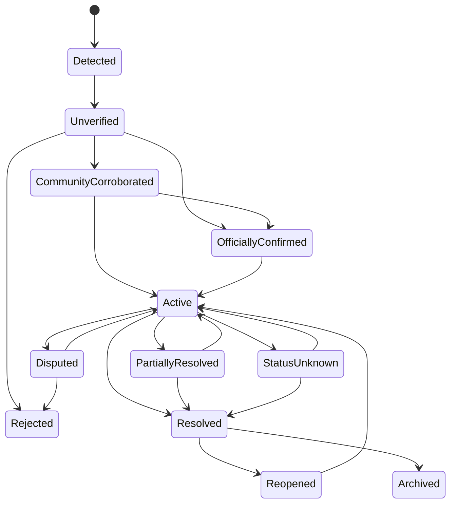
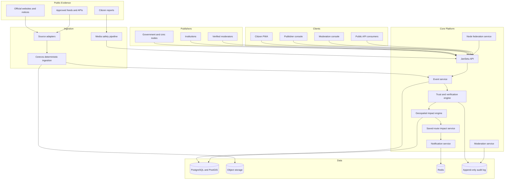

# JanSetu

> An open-source civic communication and public-response network for India.

[](ARCHITECTURE_STATUS.md)
[](LICENSE)

> **Project status: architecture baseline.** This repository currently contains
> design documents and decision records. There is no running system yet — no
> backend, frontend, database, federation or deployment. See
> [ARCHITECTURE_STATUS.md](ARCHITECTURE_STATUS.md).
>
> All city, national and billion-record figures in these documents are
> **architectural scenarios based on documented assumptions, not production
> claims.** Nothing here has been measured against a running system.

**Start with the [architecture index](docs/architecture/README.md).**


JanSetu helps government departments, local authorities, institutions and citizens share **verified, location-aware and actionable public information** through one simple interface.

It is designed for situations where important information currently remains fragmented across:

* government websites;
* police social-media accounts;
* municipal notices;
* transport announcements;
* PDFs and press releases;
* local WhatsApp groups;
* news reports;
* helpline numbers;
* citizen complaints.

A road may be closed, water supply may be interrupted, an underpass may be flooded, a metro station may be unavailable or a public service may move to another location—but many affected citizens discover this only after reaching the area.

JanSetu creates a common communication layer between public institutions and the people affected by their decisions.

---

## The problem

India does not lack public information.

It lacks a dependable way to answer:

1. What happened?
2. Where did it happen?
3. Who issued the information?
4. Is it verified?
5. Does it affect me?
6. What should I do?
7. Has the situation changed?
8. Can citizens report that the official status no longer matches reality?

### Example

A commuter checks a navigation application:

```text
Estimated journey: 50 minutes
```

The journey actually takes 90 minutes because:

* a road was temporarily blocked;
* a local event caused crowding;
* an underpass became waterlogged;
* a diversion notice was published on a police website;
* the navigation application had not yet incorporated the change.

JanSetu would notify the commuter:

```text
Your saved route may be affected.

University Road:
Temporary restriction officially announced.

Sangamwadi:
Heavy crowding confirmed by multiple recent reports.

Last verified:
7 minutes ago.

Recommended action:
Leave earlier or review another route in your preferred navigation app.
```

JanSetu does not replace navigation applications.

It provides the public-information and verification layer that helps people make better decisions before beginning their journey.

---

# Vision

Create a public digital network where:

* government bodies can publish verified, structured updates;
* citizens receive only updates relevant to their location or saved routes;
* public notices become searchable and machine-readable;
* community observations can confirm, challenge or update ground reality;
* every important claim shows its source and freshness;
* unresolved or unknown situations are displayed honestly;
* cities can deploy their own JanSetu node while remaining connected to a shared open standard.

---

# Core concept: Civic Nodes

Every participating organisation can operate a verified **JanSetu Node**.

Examples:

```text
Pune Traffic Police Node
Pune Municipal Corporation Node
Pune Metro Node
PCMC Water Department Node
District Disaster Management Node
Public Hospital Node
University Node
Citizen Community Node
```

Each node can publish events within its authorised domain.

A traffic-police node may publish:

* road closures;
* diversions;
* procession routes;
* parking restrictions;
* major accidents.

A municipal node may publish:

* water interruptions;
* flooded roads;
* road repairs;
* waste-collection disruptions;
* damaged infrastructure.

A transport node may publish:

* station closures;
* route changes;
* service delays;
* entry-gate restrictions.

A hospital or university node may publish:

* facility closure;
* location changes;
* emergency instructions;
* examination-centre updates.

Nodes remain independent but follow a common data and verification protocol.

---

# Product principles

## 1. Verified truth over confident presentation

JanSetu must display the difference between:

```text
Officially confirmed
Verified by multiple independent reports
Reported but unverified
Conflicting information
Status unknown
Source unavailable
Resolved
Stale — verification required
```

Missing information must never be converted into certainty.

---

## 2. Simple enough for every citizen

The primary interface must answer:

```text
What is happening?
Does it affect me?
What should I do?
When was this last verified?
```

The product must work for people who do not understand:

* government department structures;
* technical maps;
* administrative terminology;
* complex dashboards;
* English-only interfaces.

---

## 3. Relevant information, not another noisy feed

Citizens should receive updates based on:

* saved routes;
* current area;
* selected neighbourhoods;
* public-transport lines;
* schools, hospitals or offices they follow;
* alert categories they explicitly choose.

JanSetu must not become another endless social feed.

---

## 4. Evidence must remain inspectable

Every public event should include:

* issuing organisation;
* source document;
* publication time;
* affected location;
* current status;
* last verification;
* supporting observations;
* contradictory observations;
* known limitations.

---

## 5. Citizens can correct reality without replacing authority

Citizen reports provide ground truth, but one report does not automatically become a confirmed public event.

Community evidence may:

* corroborate an official update;
* report that a restriction remains active;
* report partial reopening;
* report that the location is incorrect;
* report that the issue has worsened;
* challenge an outdated status.

Official authority and community observation remain visibly separate.

---

## 6. Privacy by default

JanSetu must not publicly expose:

* reporter identity;
* exact reporter movement;
* saved personal routes;
* political affiliation;
* faces;
* vehicle-registration numbers;
* private phone numbers;
* continuous location history;
* identities of protesters or public officials;
* sensitive emergency infrastructure.

---

## 7. Open infrastructure, not platform lock-in

Cities, institutions and communities should be able to deploy JanSetu without depending on one private vendor.

The project should provide:

* open-source reference implementation;
* documented event protocol;
* source-adapter SDK;
* node-federation protocol;
* deployment guides;
* public APIs where data licensing allows;
* portable data export.

---

# Primary use cases

## Commute disruption

A user receives an alert when a verified event affects a saved route.

## Water or electricity interruption

A local authority publishes an affected area, expected duration and restoration update.

## Flooding and severe weather

Citizens see verified waterlogging, dangerous road segments and official instructions.

## Public transport disruption

A metro, bus or railway node publishes station, route or timetable changes.

## Public event or procession

Authorities communicate affected roads and expected timings without exposing participant identities.

## Examination or university update

Institutions publish centre changes, postponements or access instructions.

## Hospital or public-service change

A hospital, vaccination centre or government office communicates closures or temporary relocation.

## Local infrastructure issue

Citizens report:

* open manholes;
* dangerous potholes;
* non-functional signals;
* fallen trees;
* damaged streetlights;
* blocked drains.

Departments can acknowledge, assign and update the issue.

---

# User experience

## Home

```text
Good morning.

Two verified updates may affect you today.

Home → Office
Major road restriction
Last verified 5 minutes ago

Neighbourhood
Water supply interruption until 14:00

[View details]
```

---

## Explore

Citizens can browse:

```text
Near me
My routes
My neighbourhood
Transport
Water
Roads
Weather
Health
Education
Public services
```

A list view must always be available alongside the map.

---

## Event details

```text
UNIVERSITY ROAD RESTRICTION

Status:
Officially confirmed

Issued by:
Pune Traffic Police

Started:
07:10

Expected end:
Not provided

Last verified:
07:42

Affected:
University Chowk to Range Hills

Evidence:
Official advisory
Eight community confirmations
One report of partial access

What we do not know:
Exact reopening time

[Still active]
[Partially open]
[Cleared]
[Incorrect information]
```

---

## Report an issue

```text
What is happening?

[Road blocked]
[Waterlogging]
[Accident]
[Public transport issue]
[Water supply issue]
[Electricity issue]
[Damaged infrastructure]
[Heavy crowding]
[Other]

Where?
[Use approximate current area]
[Choose on map]

Optional:
Photo
Short description

Your report will remain unverified until supported
by additional evidence or reviewed by an authorised node.
```

---

## Official publisher console

Verified organisations can:

* create an event;
* define affected geography;
* attach an official notice;
* schedule activation;
* publish updates;
* mark partial restoration;
* request citizen verification;
* resolve an event;
* view affected-route estimates;
* respond to conflicting evidence;
* export an audit history.

---

## Moderation console

Maintainers can review:

```text
New citizen reports
Potential duplicate events
Conflicting reports
Stale active events
Source failures
Abuse reports
Location corrections
Media requiring redaction
```

Every moderation action must create an audit record.

---

# Event categories

```text
ROAD_CLOSURE
ROAD_RESTRICTION
ACCIDENT
TRAFFIC_SIGNAL_FAILURE
WATERLOGGING
FLOODING
ROAD_DAMAGE
PUBLIC_EVENT
TRANSIT_DELAY
TRANSIT_CLOSURE
WATER_INTERRUPTION
POWER_INTERRUPTION
PUBLIC_SERVICE_CLOSURE
HEALTH_ADVISORY
WEATHER_WARNING
EDUCATION_UPDATE
EMERGENCY_GUIDANCE
INFRASTRUCTURE_DAMAGE
OTHER
```

---

# Event lifecycle



Every transition must store:

```text
Previous state
New state
Supporting evidence
Contradictory evidence
Actor
Reason
Timestamp
Ruleset version
```

---

# Civic ontology

## Core objects

```text
Citizen
Organisation
GovernmentDepartment
CivicNode
AdministrativeArea
RoadSegment
TransitLine
TransitStation
PublicFacility
SavedRoute
FollowedLocation
PublicEvent
CitizenReport
OfficialNotice
EvidenceItem
VerificationEvent
DepartmentAssignment
ResolutionUpdate
Notification
SourceAdapter
ModerationAction
```

## Core relationships

```text
Organisation OPERATES CivicNode
CivicNode PUBLISHES PublicEvent
PublicEvent AFFECTS AdministrativeArea
PublicEvent AFFECTS RoadSegment
PublicEvent AFFECTS TransitStation
PublicEvent AFFECTS PublicFacility
CitizenReport SUPPORTS PublicEvent
CitizenReport CONTRADICTS PublicEvent
OfficialNotice SUPPORTS PublicEvent
SavedRoute INTERSECTS PublicEvent
Citizen FOLLOWS AdministrativeArea
PublicEvent ASSIGNED_TO GovernmentDepartment
GovernmentDepartment UPDATES PublicEvent
VerificationEvent TRANSITIONS PublicEvent
PublicEvent GENERATES Notification
```

---

# Architecture overview



---

# Cerevra integration

Cerevra acts as the deterministic ingestion and provenance layer for official public information.

It provides:

* write-ahead logging;
* crash-safe ingestion;
* deterministic replay;
* content fingerprinting;
* duplicate prevention;
* namespace isolation;
* source version history;
* parser-version tracking;
* reproducible reprocessing;
* retrieval with complete provenance.

Example namespaces:

```text
india/maharashtra/pune/traffic-police
india/maharashtra/pune/municipal-corporation
india/maharashtra/pune/metro
india/maharashtra/pcmc/water
india/madhya-pradesh/jabalpur/municipal-corporation
india/national/cpcb/air-quality
```

Cerevra preserves evidence.

It does not independently decide that an event is true.

---

# Verification model

JanSetu should not display a single mysterious confidence score.

It should explain the evidence.

```text
Evidence strength: High

Why:
✓ Published by an authorised civic node
✓ Official source document attached
✓ Nine recent geographically consistent confirmations
✓ Latest confirmation three minutes ago
! Reopening time has not been provided
```

Evidence strength may consider:

```text
Source authority
Document authenticity
Number of independent reports
Report recency
Geographical consistency
Reporter reliability
Contradictory evidence
Source freshness
```

The final explanation must remain understandable to citizens.

---

# Route-impact engine

JanSetu does not provide turn-by-turn navigation.

It determines whether an event intersects or materially affects a saved route.

```text
Saved route
→ Road and transit segments
→ Active verified events
→ Spatial intersection
→ Impact classification
→ User explanation
→ Navigation deep link
```

Initial impact levels:

```text
No known impact
Possible impact
Moderate impact
Major impact
Severe impact
Unknown
```

The initial release should not claim exact delay minutes.

Exact or probabilistic delay bands may be introduced only after sufficient real journey data exists.

---

# Node federation

JanSetu should support independently operated nodes.

```text
National directory
        ↓
State node
        ↓
City or district node
        ↓
Department or institution node
```

A node should publish:

* node identity;
* public signing key;
* authorised event categories;
* geographical authority;
* API endpoint;
* supported protocol version;
* contact and escalation information;
* public audit information.

Events shared between nodes should be signed.

A node must not silently modify an event issued by another node.

It may:

* reference it;
* add local evidence;
* publish a correction request;
* publish a related local event;
* mark the upstream source unavailable.

---

# Suggested technology

```text
Frontend
  Next.js
  TypeScript
  Progressive Web App
  MapLibre GL JS
  Accessible list interface

Backend
  Python
  FastAPI
  Pydantic
  SQLAlchemy

Data
  PostgreSQL
  PostGIS
  Redis for short-lived state
  S3-compatible object storage

Ingestion
  Cerevra
  Source-adapter SDK
  Worker process

Routing
  OSRM or another open routing service
  OpenStreetMap-derived road network

Observability
  OpenTelemetry
  Prometheus
  Grafana

Testing
  pytest
  Playwright
  contract tests
  replay tests
  geospatial fixture tests
  abuse and moderation tests
```

The initial system should be a modular monolith.

Microservices and Kubernetes are not required for the first usable release.

---

# Repository structure

```text
jansetu/
├── apps/
│   ├── citizen-web/
│   ├── publisher-console/
│   ├── moderation-console/
│   └── api/
├── modules/
│   ├── events/
│   ├── evidence/
│   ├── civic-nodes/
│   ├── geospatial/
│   ├── saved-routes/
│   ├── reports/
│   ├── moderation/
│   ├── notifications/
│   └── federation/
├── packages/
│   ├── contracts/
│   ├── source-adapter-sdk/
│   ├── node-sdk/
│   ├── localisation/
│   └── ui/
├── infrastructure/
│   ├── docker/
│   ├── migrations/
│   └── observability/
├── docs/
│   ├── PRODUCT.md
│   ├── ARCHITECTURE.md
│   ├── ONTOLOGY.md
│   ├── TRUST_MODEL.md
│   ├── PRIVACY.md
│   ├── MODERATION.md
│   ├── FEDERATION.md
│   ├── SOURCE_REGISTRY.md
│   └── adr/
├── tests/
│   ├── integration/
│   ├── geospatial/
│   ├── replay/
│   ├── federation/
│   └── abuse/
├── CONTRIBUTING.md
├── CODE_OF_CONDUCT.md
├── GOVERNANCE.md
├── SECURITY.md
├── NOTICE
├── LICENSE
└── README.md
```

---

# Delivery phases

## PMVP — Public communication proof

The PMVP proves:

> A verified organisation can publish an event, citizens in the affected area can discover it and the complete evidence trail remains inspectable.

Included:

* one pilot city;
* responsive PWA;
* public event list;
* simple event map;
* verified publisher accounts;
* manual official-event publishing;
* event evidence page;
* location and category subscriptions;
* browser notifications;
* source freshness;
* English interface;
* moderation console;
* audit trail;
* no anonymous public reporting.

---

## MVP — Two-way civic communication

Included:

* citizen reports;
* one-tap event verification;
* conflicting-evidence handling;
* saved routes;
* route-impact alerts;
* official-source ingestion through Cerevra;
* event deduplication;
* image metadata removal;
* location rounding;
* abuse controls;
* Marathi and Hindi;
* source registry;
* low-bandwidth list mode;
* public issue-resolution updates;
* contributor onboarding;
* public accuracy report.

---

## V1 — Open civic network

Included:

* multiple civic nodes;
* signed node events;
* node-federation protocol;
* department assignment;
* acknowledgement and resolution tracking;
* transport integrations;
* configurable city taxonomies;
* source-adapter SDK;
* node deployment kit;
* public API;
* accessibility certification;
* independent moderation workflow;
* operational status page.

---

## Future

Only after trust and adoption exist:

* IVR and feature-phone support;
* SMS alerts;
* WhatsApp-compatible public notifications through authorised channels;
* disaster-response mode;
* public-service SLA analytics;
* privacy-preserving aggregate commute observations;
* city reliability reports;
* verified media integrations;
* public dashboards for unresolved civic issues;
* cross-city federation;
* native mobile applications.

---

# Open-source contribution model

Contributions are welcome from:

* backend developers;
* frontend developers;
* geospatial engineers;
* public-policy researchers;
* civic-data volunteers;
* security researchers;
* privacy specialists;
* UX designers;
* accessibility experts;
* Marathi, Hindi and regional-language contributors;
* public-transport researchers;
* government technology teams;
* students and local communities.

---

## Good first issues

```text
Add a synthetic civic-event fixture
Write a PostGIS route-intersection test
Improve the accessible event list
Translate one screen into Marathi
Document a permitted public source
Add a source-adapter parser fixture
Improve event timeline UI
Add a WAL replay regression test
Test duplicate event suppression
Improve media metadata removal
Create a civic-node signing example
Document one Pune public-service workflow
```

---

## Suggested labels

```text
good-first-issue
backend
frontend
geospatial
civic-node
source-adapter
federation
accessibility
localisation
privacy
security
moderation
observability
documentation
user-research
public-policy
```

---

## Contribution requirements

Every contribution should explain:

1. What citizen problem does this solve?
2. What evidence supports the need?
3. Which user or organisation benefits?
4. What privacy risks exist?
5. What abuse scenarios exist?
6. How will the behaviour be tested?
7. What remains unsupported or unknown?

Large architectural changes require an RFC or ADR before implementation.

---

# Governance

JanSetu should not be controlled by one individual indefinitely.

The project should establish:

* transparent maintainer roles;
* documented decision-making;
* public architectural proposals;
* security-reporting process;
* conflict-of-interest disclosure;
* community moderation rules;
* release-signing process;
* node-certification criteria;
* appeals process;
* contributor code of conduct.

No political party, government body or private company should receive hidden moderation privileges.

---

# Safety boundaries

JanSetu must never become:

* a protester-tracking system;
* a political-opinion database;
* a facial-recognition platform;
* a police movement tracker;
* a personal travel-history marketplace;
* a public accusation feed;
* a predictive-policing system;
* a system for identifying people at public events;
* an automated authority for emergency decisions.

The platform communicates public operational information.

It does not profile people.

---

# Success measurement

North-star metric:

> People who received a verified and useful public update before the issue caused avoidable harm, delay or confusion.

Supporting metrics:

```text
Weekly active local users
Followed areas and routes
Official events published
Events with complete provenance
Notification usefulness
Confirmed false-alert rate
Median time to verification
Median time to status update
Source freshness
Citizen reports independently corroborated
Issues acknowledged by civic nodes
Issues resolved with public evidence
Repeat weekly use
Regional-language usage
External contributors
Independent civic-node deployments
```

Claims such as “minutes saved” or “citizens helped” must not be published without a defensible measurement method.

---

# Local development

```bash
git clone <repository-url>
cd jansetu

cp .env.example .env
docker compose up --build
```

Expected services:

```text
Citizen web: http://localhost:3000
Publisher console: http://localhost:3001
Moderation console: http://localhost:3002
API: http://localhost:8000
API documentation: http://localhost:8000/docs
```

Seed a synthetic city demonstration:

```bash
make seed-demo
```

Run validation:

```bash
make test
make lint
make typecheck
make replay-test
make geospatial-test
```

---

# Licence recommendation

```text
Code:
Apache License 2.0

Documentation:
Creative Commons Attribution 4.0

External datasets:
Original source licence

Citizen submissions:
Explicit submission and privacy terms
```

All map, data and source attributions must be preserved.

---

# Initial pilot

The proposed first pilot is:

```text
Region:
Pune and Pimpri-Chinchwad

Initial categories:
Road restrictions
Waterlogging
Public-transport disruptions
Water interruptions
Major public-service updates

Initial publishers:
Project maintainers using verified public notices

Initial users:
Daily commuters
Students
Delivery workers
Parents
Local communities
```

Government integration is not required for the PMVP.

The system must first prove that:

* citizens understand it;
* information is trustworthy;
* notifications are useful;
* the moderation model works;
* the architecture can be independently deployed.

---

# Current call for contributors

JanSetu is seeking early contributors interested in:

* Indian civic technology;
* public communication;
* PostGIS and geospatial systems;
* deterministic evidence ingestion;
* accessible mapping;
* public-source adapters;
* privacy and abuse resistance;
* regional-language interfaces;
* open government infrastructure;
* civic-node federation;
* public-interest product design.

Open an issue containing:

```text
Problem
Affected users
Location
Available evidence
Proposed contribution
Privacy concerns
Licensing concerns
Testing approach
```

---

# Final objective

JanSetu succeeds when a citizen can say:

> “The right information reached me before I was affected, I understood what to do and I could verify where the information came from.”

It succeeds when an institution can say:

> “We communicated one verified update once, and every affected citizen, application and local node could consume it correctly.”

And it succeeds as open source when another city can deploy its own node without asking permission from the original creators.

**JanSetu is not another information feed.**

**It is open infrastructure for trusted public communication.**
