# Architecture Diagrams

Twenty purpose-specific diagrams. Each states its purpose, applicability, the invariant it protects, the failure mode it makes visible, and whether it describes PMVP or a later scale.

---

## 1. PMVP request architecture

**Purpose:** the whole PMVP in one picture. **Applies:** Scenario A. **Invariant:** I10 — cache loss cannot destroy authoritative state. **Failure mode:** none singular; this is the baseline. **Phase:** PMVP.

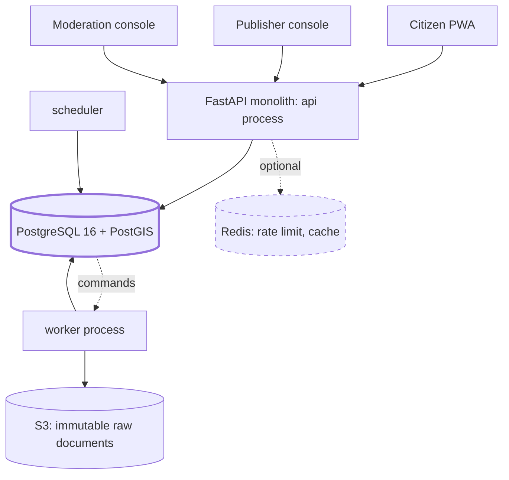

Redis is dashed because every path through it must work when it is absent.

---

## 2. Three-tier logical architecture

**Purpose:** enforce dependency direction. **Applies:** all scales. **Invariant:** module boundaries; I22. **Failure mode:** boundary erosion via cross-module joins. **Phase:** PMVP onward.

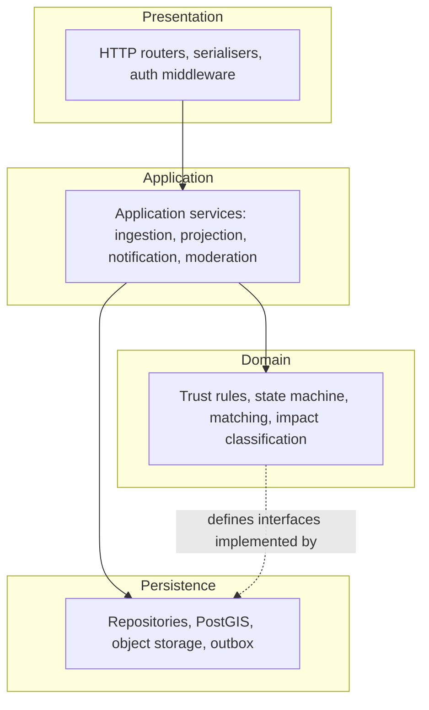

Dependencies point inward only. Enforced by `import-linter` in CI, not by convention.

---

## 3. Source-ingestion pipeline

**Purpose:** the full write path. **Applies:** all scales. **Invariants:** I1, I2, I7, I11. **Failure mode:** duplicate effects; dangling object references. **Phase:** PMVP.

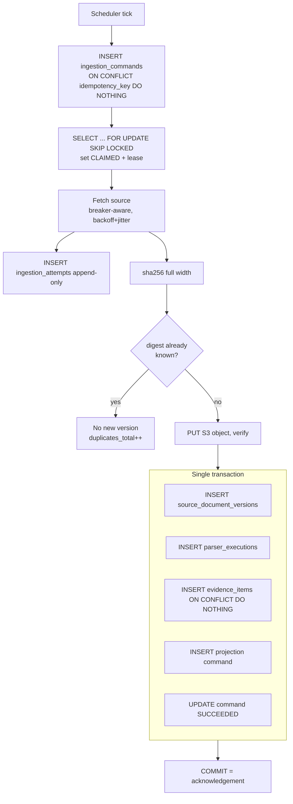

Object is written and verified **before** the referencing row commits. An orphan object is harmless; a dangling reference is not.

---

## 4. Acknowledgement boundary

**Purpose:** show precisely where durability is established. **Applies:** all scales. **Invariant:** I11. **Failure mode:** a crash losing an acknowledged command. **Phase:** PMVP.

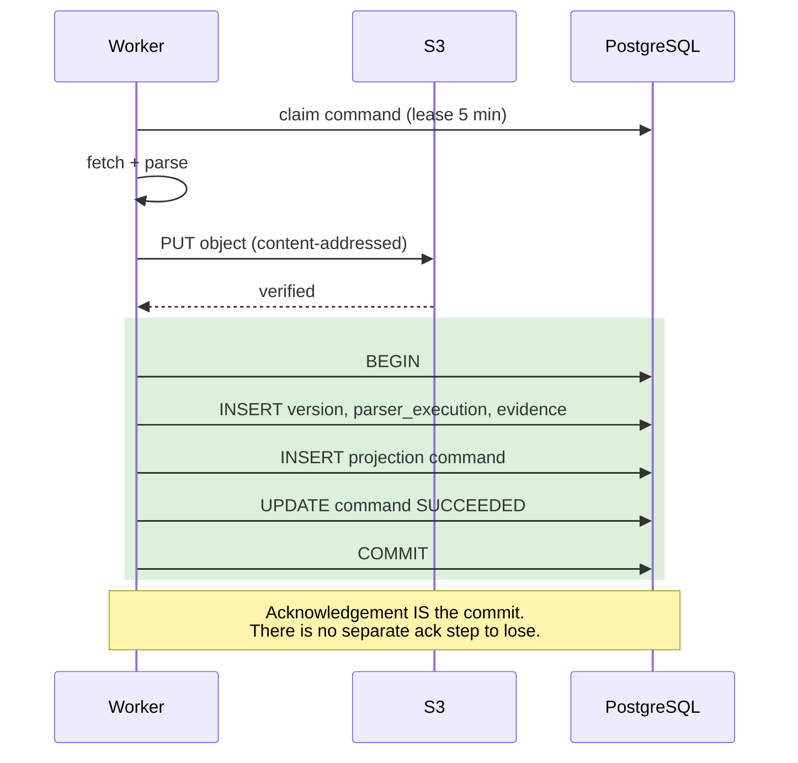

This is the design consequence of the audit finding that Cerevra's recovery engine reads a WAL stack its ingestion path never writes to (`cerevra/wal/recovery.py:17`). Making the log a table removes that class of mismatch entirely.

---

## 5. Crash and replay sequence

**Purpose:** show recovery from each crash point. **Applies:** all scales. **Invariants:** I2, I11. **Failure mode:** lost or duplicated work. **Phase:** PMVP.

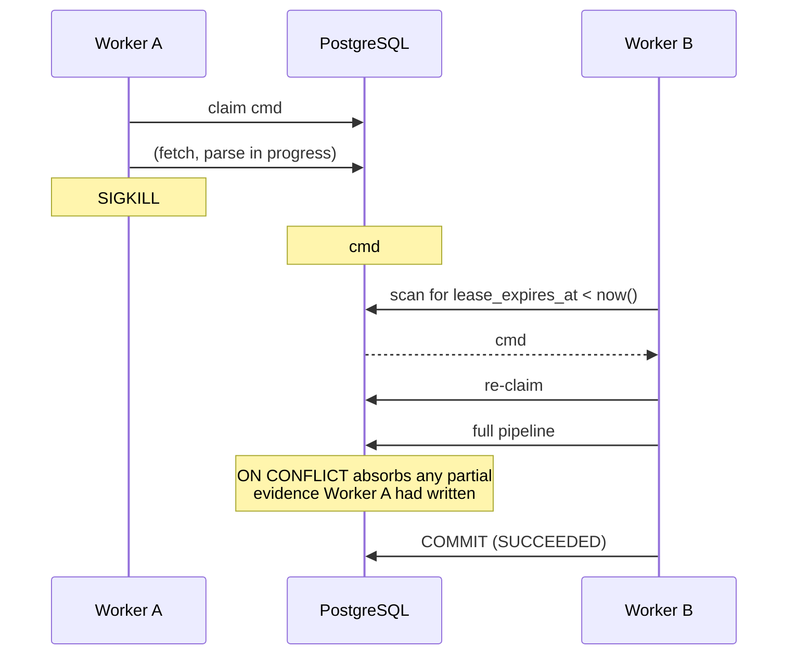

Recovery is lease expiry. There is no separate startup recovery pass, therefore none to get wrong.

---

## 6. Evidence-to-event projection

**Purpose:** the derivation of public truth. **Applies:** all scales. **Invariants:** I3, I6, I12, I13. **Failure mode:** projection divergence. **Phase:** PMVP.

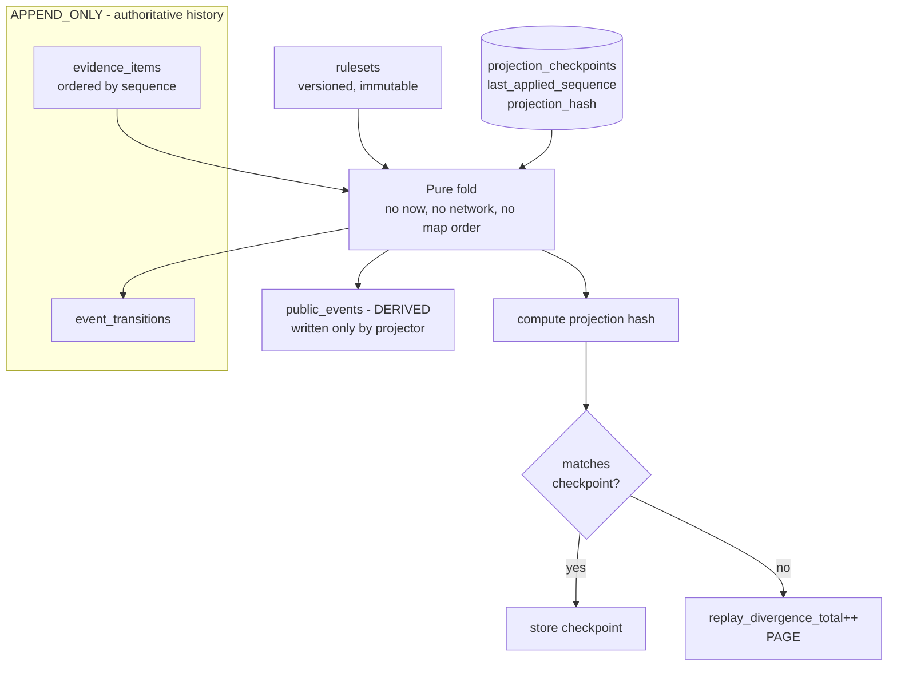

The divergence check is what Cerevra lacks entirely — it stores no projection hash, so a code change silently yields a different manifest. Without this branch, "every event is reconstructable" is an unfalsifiable claim.

---

## 7. Event state machine

**Purpose:** legal transitions. **Applies:** all scales. **Invariants:** I3, I4. **Failure mode:** an event resolving through silence, or community reports producing official confirmation. **Phase:** PMVP.

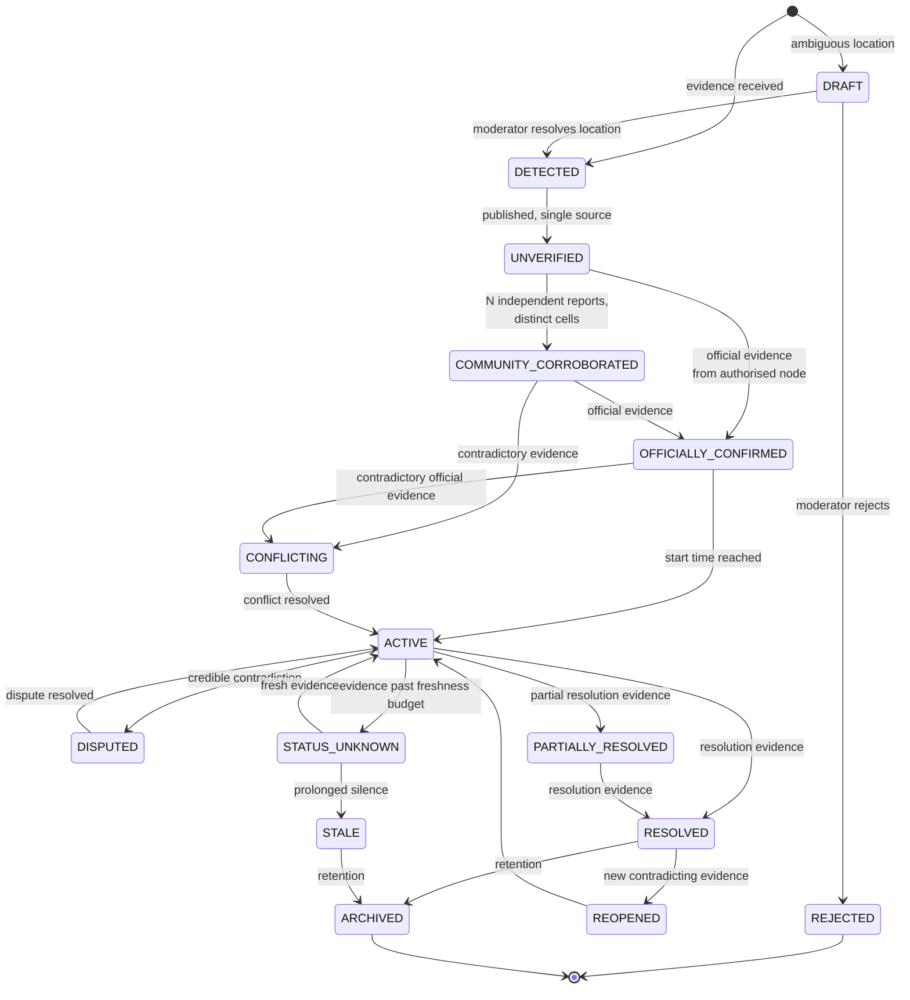

**There is no edge from any state to `RESOLVED` that is not labelled with resolution evidence.** Silence leads to `STATUS_UNKNOWN` and then `STALE` — never to resolution (I4). Likewise, no edge reaches `OFFICIALLY_CONFIRMED` without official evidence (I3).

---

## 8. Cache-aside read path

**Purpose:** read path with correct staleness handling. **Applies:** city scale onward. **Invariant:** I5, I10. **Failure mode:** a cached "road open" surviving a real closure. **Phase:** city.

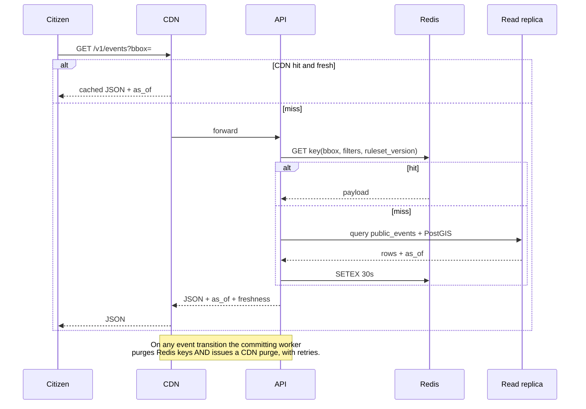

Purge-on-transition is a correctness requirement, not an optimisation.

---

## 9. Geospatial impact calculation

**Purpose:** route × event intersection. **Applies:** all scales. **Invariant:** I17 — routes never become public. **Failure mode:** route data leaking into a public response. **Phase:** PMVP.

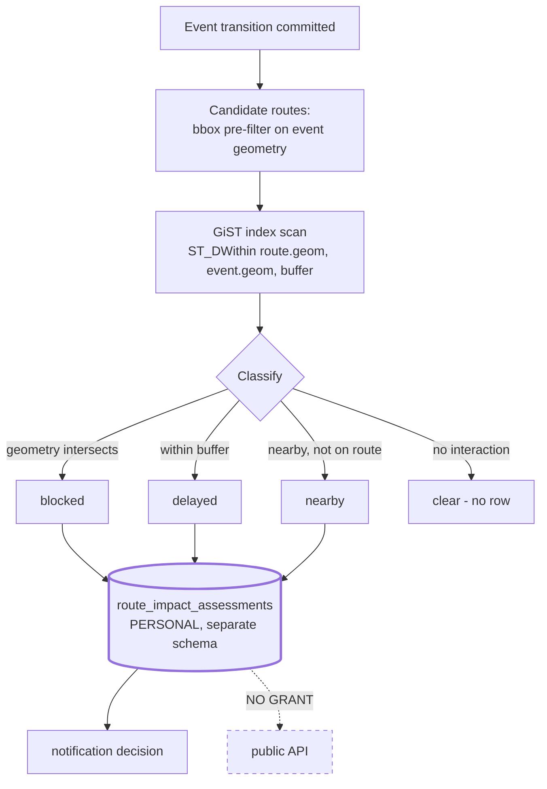

The dashed, ungranted edge is the point of the diagram. At city scale an H3 coarse pre-filter may replace the bbox step; PostGIS remains authoritative.

---

## 10. Notification fan-out

**Purpose:** delivery with dedup and prioritisation. **Applies:** all scales. **Invariants:** I9, I23. **Failure mode:** duplicate alerts; alert fatigue. **Phase:** PMVP (simple) → national (prioritised).

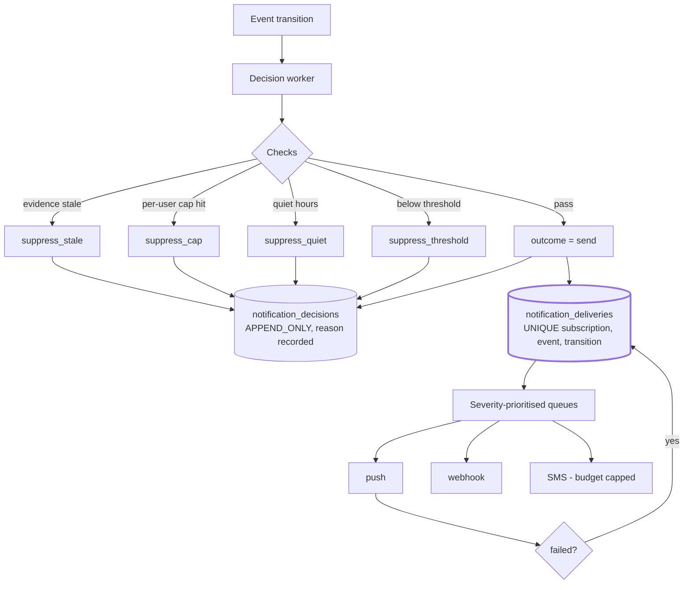

Retries re-attempt the **same row**; the unique key makes duplicate sends impossible. Suppressions are recorded with a reason — "we chose not to alert you" must be auditable.

---

## 11. Circuit breaker for failing sources

**Purpose:** protect the source and surface the failure to citizens. **Applies:** all scales. **Invariants:** I4, I15. **Failure mode:** an event silently freezing, or silently resolving, because its source went dark. **Phase:** PMVP.

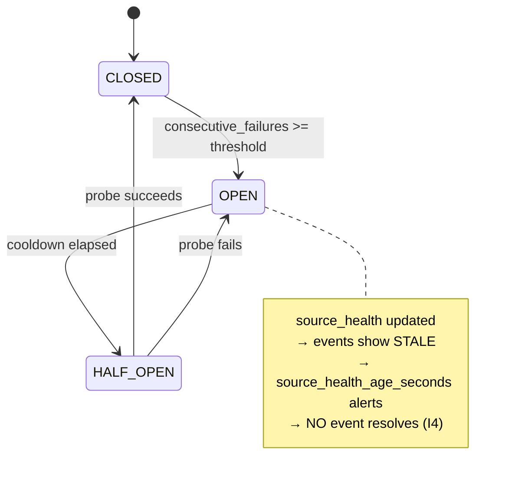

The note is the important part: an open breaker must produce a **visible** civic state, not merely an operational metric.

---

## 12. City-scale architecture

**Purpose:** what changes at Scenario B. **Applies:** city. **Invariant:** I13 — checkpointed replay. **Failure mode:** replica lag rendering a live closure absent. **Phase:** city.

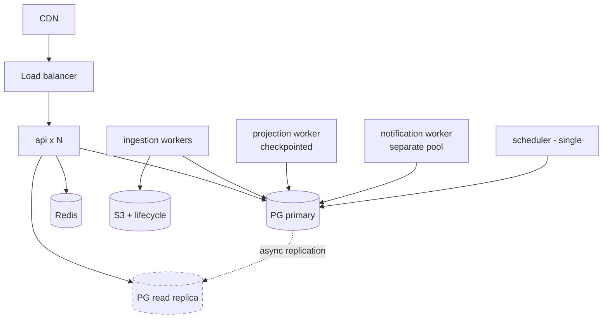

Same image, five process types. Writes and read-your-own-write paths go to the primary. If lag exceeds the freshness budget the router fails back to the primary and alerts, rather than serving stale civic data.

---

## 13. Database partitioning

**Purpose:** partition strategy per table. **Applies:** city onward. **Invariant:** retention without bulk deletes. **Failure mode:** maintenance windows exceeding the availability budget. **Phase:** city.

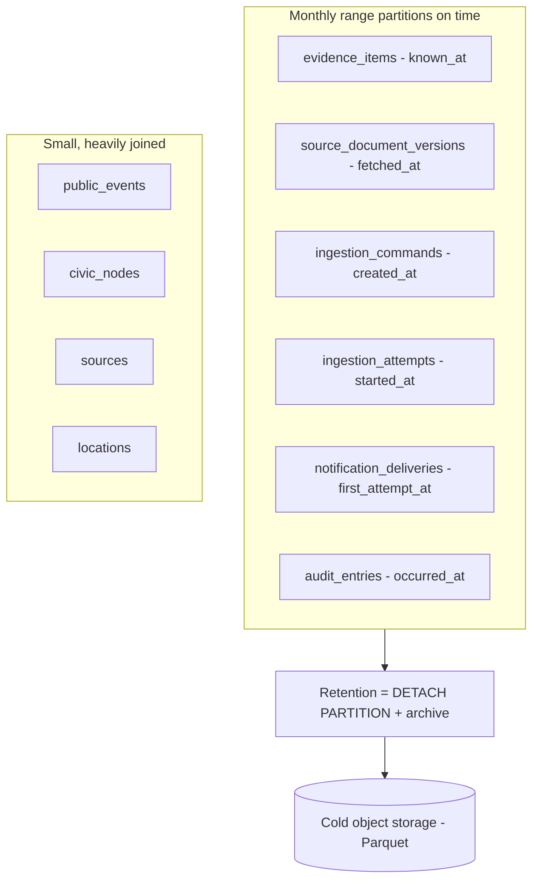

At national scale the partition key becomes `(jurisdiction, month)` — jurisdiction first, because that is what makes 128-way parallel replay possible (6.5 min versus 13.9 h).

---

## 14. National / federated architecture

**Purpose:** Scenario D shape. **Applies:** national. **Invariant:** I22 — analytics is never operational truth. **Failure mode:** the broker becoming the de facto source of truth. **Phase:** national.

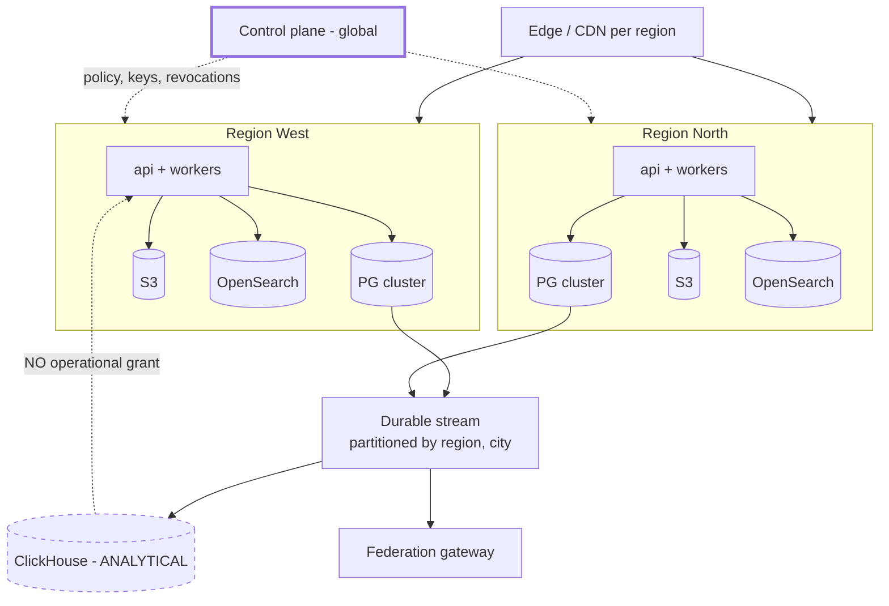

Postgres remains the system of record. The stream distributes; it never becomes authoritative.

---

## 15. Control plane / data plane separation

**Purpose:** show what survives a control-plane outage. **Applies:** national. **Invariant:** availability of civic reads during control-plane failure. **Failure mode:** control-plane outage stopping the data plane. **Phase:** national (logical from PMVP).

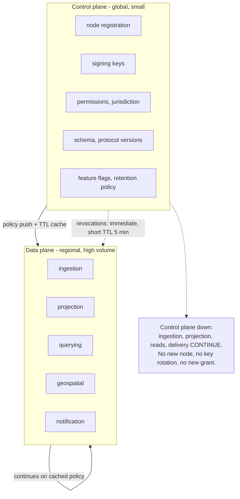

Revocation is the deliberate exception — a 5-minute signing-key TTL trades availability for the ability to cut off a compromised node quickly. That is the one place this design chooses consistency over availability, and it is chosen knowingly.

---

## 16. Civic node event signing

**Purpose:** federation trust. **Applies:** V1 onward. **Invariant:** I20. **Failure mode:** silent alteration of another node's event. **Phase:** V1.

```mermaid
sequenceDiagram
    participant N as Civic node
    participant KMS as Node KMS (JanSetu never holds this)
    participant J as JanSetu
    participant C as Citizen
    N->>N: build envelope (canonical serialisation)
    N->>KMS: sign
    KMS-->>N: signature
    N->>J: POST envelope + signature + key_id
    J->>J: lookup node_keys, check validity + revocation
    J->>J: verify signature; check nonce + issued_at window
    alt valid
        J->>J: store envelope_bytes VERBATIM, immutable
        J-->>N: accepted
    else invalid
        J->>J: federation_signature_failures_total++, quarantine, PAGE
        J-->>N: rejected
    end
    C->>J: read event
    J->>J: RE-VERIFY signature at read time
    J-->>C: event + provenance + verification status
```

Read-time re-verification is what detects tampering with data at rest. Another node may add supporting evidence, contradictory evidence, a correction request, or a note — never a mutation.

---

## 17. Hot / warm / cold lifecycle

**Purpose:** data movement and restoration. **Applies:** city onward. **Invariant:** I7 immutability preserved across tiers. **Failure mode:** archived evidence unrestorable when an audit needs it. **Phase:** city.

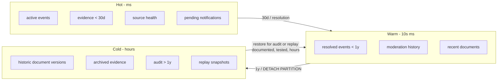

Restoration is a **tested** procedure with a stated latency. An archive that has never been restored from is an archive that cannot be.

---

## 18. Multi-region disaster recovery

**Purpose:** RPO/RTO and failover. **Applies:** national. **Invariant:** no acknowledged command lost. **Failure mode:** region loss. **Phase:** national.

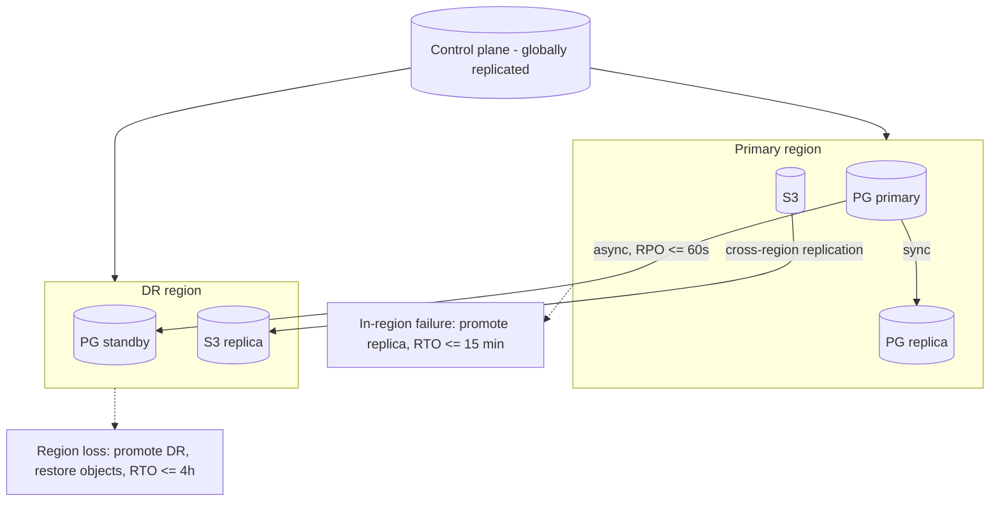

Rehearsed at least twice yearly. A DR plan that has not been executed is a document, not a plan.

---

## 19. Event merge and split

**Purpose:** history preservation through restructuring. **Applies:** all scales. **Invariants:** I18, I19. **Failure mode:** losing evidence links or breaking a public URL. **Phase:** PMVP.

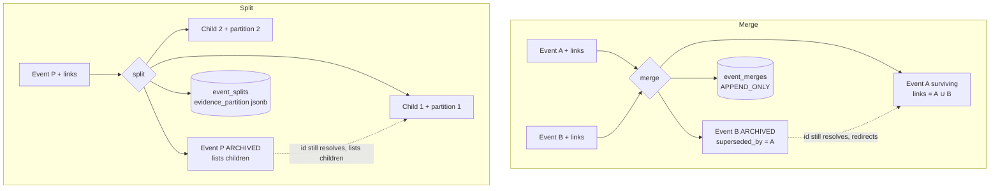

Property-tested: merge conserves the union of links; split partitions them exactly once. **Both original ids resolve forever** — a citizen who shared a link must never get a 404.

---

## 20. Search index rebuild

**Purpose:** prove search is derived. **Applies:** all scales. **Invariant:** I21. **Failure mode:** a field existing only in the index, making rebuild lossy. **Phase:** PMVP (FTS) → national (OpenSearch).

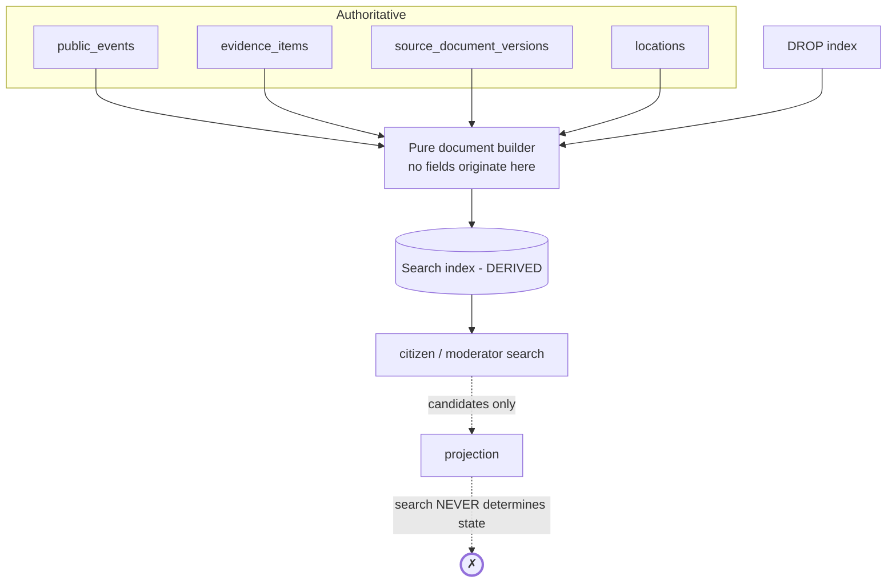

Rebuild is exercised regularly, not merely documented. The blocked edge is the point: search returns candidates; the projection determines truth.

---

## Coverage map

| Concern | Diagrams |
| --- | --- |
| Write path and durability | 3, 4, 5 |
| Truth derivation | 6, 7, 20 |
| Read path | 8, 12, 14 |
| Geospatial | 9, 13 |
| Delivery | 10 |
| Resilience | 11, 18 |
| Scale evolution | 12, 13, 14, 15, 17 |
| Trust and federation | 16, 19 |
| Structure | 1, 2 |
